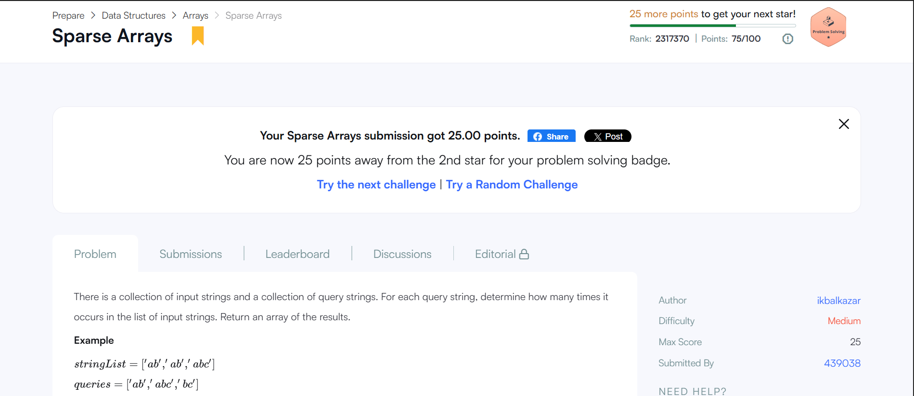

# HackerRank-3rdSem-Portfolio

Activity 8: Algorithmic Problem-Solving & Portfolio Integration (Portfolio Building B25CS0311)

**HackerRank profile:** https://www.hackerrank.com/profile/sharanu_ppatil
**Badge:** Problem Solving, 3 stars

## Required problems

| # | Problem | Language | Time | Space | Result |
|---|---|---|---|---|---|
| 1 | Diagonal Difference | C++ | O(N) | O(1) |  |
| 2 | Dynamic Array | C++ | O(N + Q) | O(N) |  |
| 3 | Time Conversion | C++ | O(1) | O(1) |  |
| 4 | Compare the Triplets | C++ | O(1) | O(1) |  |
| 5 | Sparse Arrays | C++ | O(N + Q) | O(N) |  |

## Extra problems (for the badge)
Stock Maximize, Find the Median, Closest Numbers, Mini-Max Sum.

## Badge

## Approach notes
- **Sparse Arrays:** an `unordered_map` counts each string once, so each query is an O(1) lookup instead of a nested loop.
- **Dynamic Array:** `vector<vector<int>>` with the XOR index formula.
- **Time Conversion:** only the hour changes; 12 AM and 12 PM are the special cases.